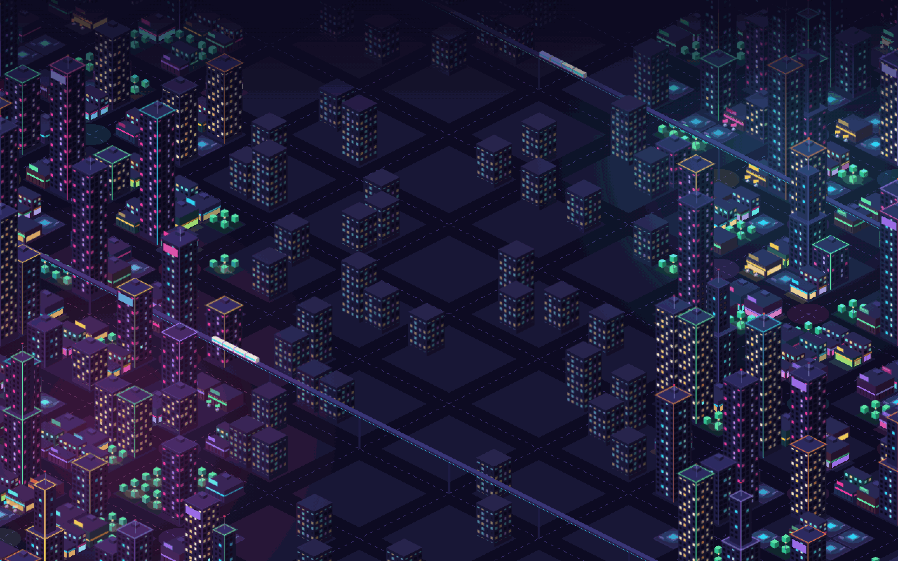

# Night theme for Claude

A tiny cyberpunk city at night, in pixel art, behind your Claude conversation:
blocky neon towers, little shops and cafés with glowing storefronts, parks,
plazas and two elevated metro lines. The middle of the city stays calm and
dark, where the conversation sits; the detail lives on the left and right
edges, which stay visible. The interface gets a matching indigo palette with
magenta, cyan and yellow neon.

The background is a single still picture (2560 × 1600, about 300 KB), so the
app has nothing to animate or redraw: it costs nothing in performance.



## Install

At the prompt of a Claude Code terminal session:

```
/plugin install night-theme --marketplace payssho/claude-night-theme
```

Answer `y` to add the marketplace, then pick a scope.

From a shell:

```bash
claude plugin install night-theme --marketplace payssho/claude-night-theme
```

In the desktop app, where `/plugin` does not run: click **+** next to the
prompt box, then **Plugins**, **Add marketplace** with
`payssho/claude-night-theme`, then **Add plugin**.

## Use

- `/night-theme` turns the theme on. It is remembered, so it comes back by
  itself in your next sessions.
- `/night-theme off` puts the app's own look back.

The background shows in the desktop and mobile apps. A terminal draws no
background.

## Change the city

The city is generated, then turned into pixel art:

- `tools/scene.js` draws it as an SVG (layout, buildings, colours, metros).
- `tools/render.py` screenshots it at 1280 × 800 with a headless Edge or
  Chrome, reduces it to a 128-colour palette without dithering and scales
  every pixel up into a 2 × 2 block.

```bash
pip install pillow
python tools/render.py
```

This rewrites `assets/night-city.png`. Run `/reload-plugins` to see it.

The interface colours are in `hooks/palette.js`.
