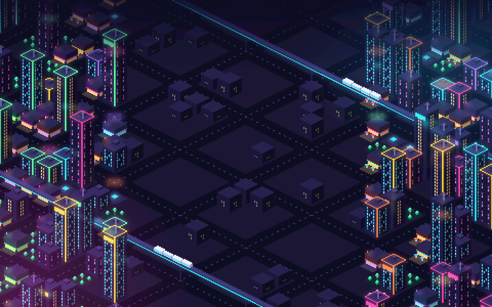

# Night theme for Claude

A tiny cyberpunk city at night, in pixel art, behind your Claude conversation:
blocky neon towers, little shops and cafés with glowing storefronts, parks,
plazas and two elevated metro lines. The middle of the city stays calm and
dark, where the conversation sits; the detail lives on the left and right
edges, which stay visible. The interface gets a matching indigo palette with
magenta, cyan and yellow neon.

The background is completely still, drawn by the app as a plain picture, so
it has nothing to animate or redraw: it costs nothing in performance.



## Install

At the prompt of a Claude Code terminal session:

```
/plugin install night-theme --marketplace payssho/claude-themes
```

Answer `y` to add the marketplace, then pick a scope.

From a shell:

```bash
claude plugin install night-theme --marketplace payssho/claude-themes
```

In the desktop app, where `/plugin` does not run: click **+** next to the
prompt box, then **Plugins**, **Add marketplace** with
`payssho/claude-themes`, then **Add plugin**.

## Use

- `/night-theme` turns the theme on. It is remembered, so it comes back by
  itself in your next sessions.
- `/night-theme off` puts the app's own look back.

The background shows in the desktop and mobile apps. A terminal draws no
background.

## Change the city

`tools/build.py` writes the city as an SVG on a 480 × 300 pixel grid, one
unit per pixel: isometric blocks with window patterns on their faces, neon
outlines with a soft glow. A mosaic filter samples it once per unit, so
everything comes out as crisp square pixels with stair-stepped edges. Each
kind of building is drawn once and reused, so the scene stays small.

It writes:

- `hooks/scene.js`: the scene the plugin shows as the background.
- `assets/night-city.png`: a preview, the picture at the top of this page
  (made with a headless Edge or Chrome when one is found).

```bash
python night-theme/tools/build.py
```

Then run `/reload-plugins` and `/night-theme` to see it. The layout, sizes and
colours are constants at the top of `build.py`; the interface colours are in
`hooks/palette.js`.
